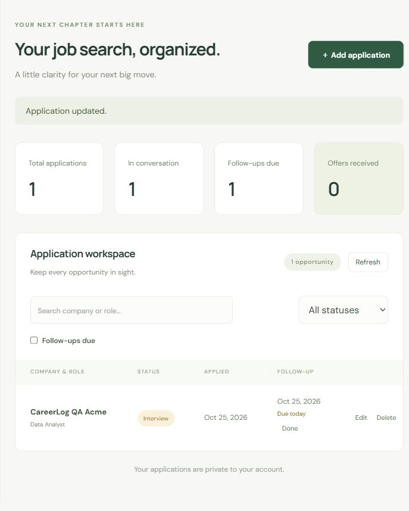

# CareerLog

A focused job application tracker built with **HTML, CSS, JavaScript, and Supabase**. Keep applications, notes, statuses, and follow-up dates together in a private workspace.

[Hosted app](https://careerlog-rush199.livelytrout2.chatgpt.site) · [Architecture](docs/ARCHITECTURE.md) · [Testing](docs/TESTING.md)

> The hosted copy currently requires the owner's ChatGPT access before the app's own login. The source can be hosted on any static host. Public signup also needs Supabase email delivery configured for external users.

## Features

- Email/password signup, confirmation resending, login, logout, and password recovery.
- Create, edit, delete, and persist applications with notes.
- Applied, Interview, Offer, and Rejected statuses.
- Company/role search, status filtering, and a due-follow-up filter.
- Dashboard totals for applications, interviews, due follow-ups, and offers.
- Overdue, due-today, and upcoming labels; Done clears a completed follow-up.
- Database ownership policies, validation, loading/error feedback, and duplicate-action protection.
- Responsive layout and accessible labels/dialogs.

## Screenshots




Screenshots use synthetic data wherever applications are shown. No demo credentials are embedded in the app.

## Stack

The frontend uses native ES modules with no build step. Supabase provides authentication, PostgreSQL, and its Data API. Node.js runs the local server and tests. LinkeDOM and Prettier are development dependencies only.

## Run locally

Use Node.js 22 or later.

```sh
git clone https://github.com/Rush199/CareerLog.git
cd CareerLog
npm ci
npm start
```

Open http://127.0.0.1:4173. Internet access is required for Supabase and the version-pinned SDK on esm.sh. Fonts have a system-font fallback.

## Configure your own Supabase project

1. Create a project and keep email/password authentication enabled.
2. Run `schema.sql` once in the SQL editor of an empty project. It creates the table, constraints, index, and four ownership policies.
3. Use `dist/config.example.js` as a template for `dist/config.js`. Set your project URL and **publishable** key.
4. Set `AUTH_REDIRECT_URL` to your local or hosted origin. Use exactly the same URL in Supabase Authentication → URL Configuration for Site URL and the redirect allowlist. Use HTTPS when hosted.
5. Configure an email provider before public registration. Supabase's default mail service restricts recipients and rate-limits sending. Leave email confirmation enabled.
6. Register, open the newest confirmation email, and sign in. Old emails keep their original destination after URL settings change; request a fresh one.

The included `config.js` contains only the hosted copy's **public** URL and publishable key. These are visible to every browser by design and do not grant administrator access. Database policies enforce privacy. Never add secret/service-role keys, passwords, access tokens, or SMTP credentials to frontend files or commits.

## Checks

```sh
npm run check
npm test
npm run format:check
```

Use `npm run format` after editing. GitHub Actions runs the checks on pushes and pull requests. Tests cover auth states, rules, filtering/counts, database requests, forms, failures, and session changes. Mocked tests do not send email or prove hosted configuration. `tests/rls.sql` tests real database policies inside a rolled-back transaction; see [Testing](docs/TESTING.md).

## Project structure

```text
dist/                    Static browser files
  app.js                 Connects authentication and workspace
  auth.js                Authentication UI states
  workspace.js           Application forms and rendering
  repository.js          Supabase requests
  applications.js        Validation, follow-ups, filtering, counts
  config.js              Browser-safe configuration
schema.sql               Initial schema and ownership policies
tests/                   Regression tests and database-policy checks
docs/                    Design, verification notes, screenshots
server.mjs               Local-only static server
.github/workflows/       Automated checks
```

## Data privacy and reliability

Applications reference Supabase Auth through `user_id`. PostgreSQL restricts reads/writes to the signed-in owner, prevents ownership reassignment, and denies anonymous reads. User text is rendered as text, not HTML.

Confirmed write responses update the interface directly. Failed saves preserve form values. Refresh failures are shown separately. Sign-out clears the workspace, and late responses from an older session are ignored.

## Scope and limitations

This is a small portfolio project. Follow-ups are manually tracked dates, with no email reminders or completion history. Metrics are counts, not predictions. Records are fetched in batches and filtered locally, suitable for personal application lists. There is no offline mode, attachment storage, status history, or AI.

## Deployment

Publish `dist/` on a static host and configure matching Supabase redirects. This copy uses Sites; `.openai/hosting.json` identifies its existing hosting project. Do not reuse that ID to register a new Site. Hosting access, Supabase configuration, and GitHub visibility are separate settings.

See [the release checklist](docs/RELEASE.md) for account-dependent verification. Only claim end-to-end verification after completing the browser checklist.
